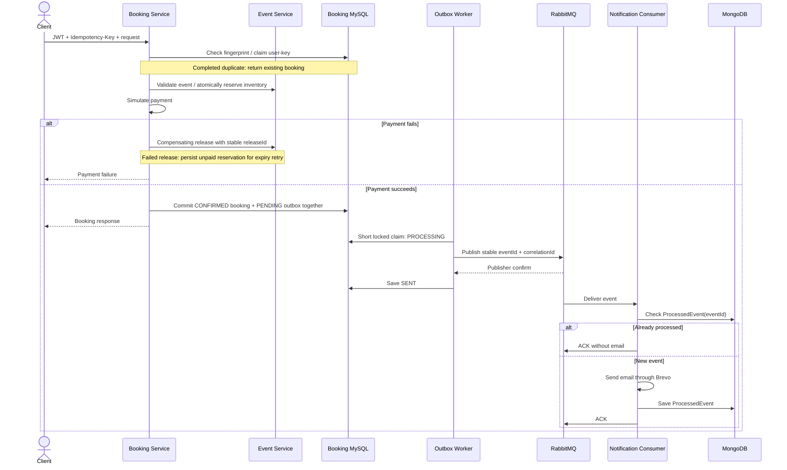

# Event Ticket Booking Platform

## Project Overview

An event discovery and ticket booking platform with a Next.js customer application and one Angular management dashboard.

- **ADMIN:** platform-wide event, booking and statistics access, plus user/category/notification administration.
- **HOST:** creates events and manages only owned events, including their booking data and statistics.
- **CUSTOMER:** discovers events, books tickets and views their own bookings.

ADMIN and HOST share the dashboard. Backend authorization uses the JWT subject and `Event.createdBy`; navigation visibility is only a presentation control.

## Architecture

| Component / repository | Responsibility and data |
|---|---|
| [Gateway](https://github.com/eventTicket-booking-platform/gateway-service-api) | Routes APIs; blocks external internal-inventory routes and restricts notification administration. |
| [Auth Service](https://github.com/eventTicket-booking-platform/auth-service-api) / Keycloak | Registration, verification, profiles and Keycloak-backed login/JWTs. Auth owns MySQL user/OTP data; Keycloak manages identity credentials. |
| [Event Service](https://github.com/eventTicket-booking-platform/event-service-api) | Owns MySQL events, ticket inventory and release receipts. |
| [Booking Service](https://github.com/eventTicket-booking-platform/booking-service-api) | Owns MySQL bookings, simulated payments, idempotency records and outbox events. |
| [Notification Service](https://github.com/eventTicket-booking-platform/notification-service-api) | Node.js consumer; owns MongoDB notification logs/processed events; sends email through Brevo. |
| [Config Server](https://github.com/eventTicket-booking-platform/config-server) / [configuration](https://github.com/eventTicket-booking-platform/config-repo) | Git-backed Spring configuration. |
| [Eureka](https://github.com/eventTicket-booking-platform/eureka-server) | Service registration/discovery infrastructure; current Feign clients also use configured URLs. |
| RabbitMQ | Asynchronous notification queues, delayed retries and dead-letter queues. |

Java/Spring Boot services coordinate validation and inventory through synchronous HTTP calls; messages trigger notifications asynchronously. Each business service owns its data: cross-service references use IDs, APIs and events, with no cross-database foreign keys. Databases may share infrastructure without sharing entity ownership.

Frontends: [customer application](https://github.com/eventTicket-booking-platform/event-ticket-booking-platform) and [shared admin/host dashboard](https://github.com/eventTicket-booking-platform/event-admin-dashboard). [Kubernetes manifests](https://github.com/eventTicket-booking-platform/k8) describe deployment; their presence does not demonstrate production availability.

## Engineering Problems Solved

| Problem | Implemented decision |
|---|---|
| Overselling under concurrency | Atomic conditional decrement only when `availableQuantity >= requestedQuantity`; zero updated rows means rejection. |
| Payment failure after reservation | Release exact quantities through Event Service. Stable release IDs and transactional receipts prevent duplicate inventory increments. |
| Duplicate booking requests | Required `Idempotency-Key`, request fingerprint and unique `(userId, idempotencyKey)` constraints. Completed requests replay the stored booking; changed bodies/in-progress claims conflict. |
| MySQL + RabbitMQ dual write | Confirmed booking and notification outbox row persist in the same local transaction; publication follows commit. |
| Multiple outbox workers | Short pessimistic claim changes `PENDING → PROCESSING`; broker I/O occurs outside that transaction. |
| Worker crash while processing | Timeout-based stale claim recovery plus an optimistic version prevents late workers overwriting newer claims. |
| Uncertain publication | Correlated publisher confirms gate the outbox transition to `SENT`. |
| At-least-once delivery / duplicates | Stable outbox-derived `eventId`, MongoDB `ProcessedEvent` lookup before email, then successful-processing persistence before ACK. |
| Temporary notification failure | TTL retry queue routes messages back, preserving/incrementing `x-attempt`. |
| Invalid or exhausted notifications | Permanent invalid messages and exhausted retries go to the DLQ with failure metadata. |
| Distributed debugging | Booking `X-Correlation-ID` flows through the outbox, event payload, consumer logs and retry/DLQ headers. This is message correlation, not a distributed-tracing system. |
| Unreleased failed reservations | Store expiry when immediate failed-payment compensation fails; scheduler retries release and marks `EXPIRED` only after success. Paid/confirmed bookings are protected. |
| Cross-host access | JWT-derived ownership; Booking Service verifies through Event Service APIs and scopes lists/statistics before pagination/aggregation. |

## Booking Reliability Flow

This normal confirmation path assumes the JWT supplies a recipient email. Payment is simulated synchronously.

Consumer delivery can precede the worker saving `SENT`. Publication failures retry through the outbox; consumer failures use retry/DLQ handling. Publisher confirmation establishes broker acceptance, not email delivery.

## Testing / Evidence

- **JUnit/Mockito and H2:** booking validation/idempotency, concurrent inventory updates, release deduplication/rollback, outbox claims/recovery, reservation expiry and backend ownership/HTTP authorization.
- **Jest:** consumer duplicate checks, duplicate-key races, missing IDs, transient retries and permanent/exhausted DLQ routing.
- **Angular tests:** dashboard access guards and ADMIN-only navigation.
- **Testcontainers (opt-in):** MySQL reservation concurrency, booking/claim uniqueness and stale outbox version protection; RabbitMQ publisher confirmation and queue delivery.

Run `mvn test` in Event and Booking Service without Docker. With Docker running Linux containers, run `mvn verify -Pintegration-tests` in each. Notification: `npm test -- --runInBand`. Dashboard: `npm test -- --watch=false`.

Recorded local Event/Booking unit suites passed and integration tests compiled. Container startup was blocked by an unavailable Docker daemon; database/broker assertions are **not yet verified by that run**.

**k6 evidence: pending.** No completed suite or measured load result is present in the inspected repositories. Before adding results, record:

- Commit/machine/configuration, scenario, VUs/attempts, quantity and initial inventory.
- Actual status counts/latency summary, before/after stock and confirmed-booking quantities.
- For idempotency: matching returned booking IDs and evidence of one stored booking.

An end-state snapshot alone cannot prove inventory was never negative. Local results must not be presented as production capacity.

## Important Trade-offs / Limitations

- **At-least-once, not exactly-once.** Email can succeed before a crash prevents `ProcessedEvent` persistence. Concurrent consumers can both pass the lookup and send; the unique index prevents duplicate records, not both emails.
- **Local transactions, not distributed atomicity.** A crash after remote reserve but before local booking commit can orphan inventory. Expiry recovers recorded failed compensation only, without inferring unrecorded operations or backfilling historical pending bookings.
- **Simulated payment.** No payment-gateway integration, asynchronous payment completion or customer booking-cancellation endpoint. Successful bookings currently need no checkout expiry window; no full Saga was introduced for this workflow.
- **Operational recovery remains necessary.** Exhausted outbox events become `FAILED`; stale idempotency claims, DLQs and orphan reservations require investigation/reconciliation. Timeouts must exceed batch duration; clocks must be reasonably synchronized. Claims can lock more rows than the published batch.
- **Messaging has a handoff gap.** RabbitMQ fits asynchronous notification/work-queue delivery. Consumer retry/DLQ forwarding uses an ordinary channel before ACK, without its own publisher-confirm handshake; this is not atomic.
- **Deployment boundaries matter.** Internal inventory commands and Notification Service require private backend ports. Historical client-supplied ownership needs auditing. Missing JWT email skips notification outbox creation.

## Local Development / Running

1. Install Java 17+, Maven (or service wrappers), and Node.js/npm compatible with the frontend packages. Provision MySQL, MongoDB, RabbitMQ and Keycloak with the configured realm/client. Email and uploads require Brevo and AWS S3 settings.
2. Clone the linked repositories. Copy Spring services' `.env.example` files to `.env`; configure credentials, JWT issuer and service URLs. Notification loads `.env`, then `.env.<NODE_ENV>`. Never commit credentials.
3. Set `CONFIG_GIT_URI` to your configuration repository; Config Server's checked-in local path must change on another machine. Start Eureka/Config Server, then business services and Gateway. Run `mvn spring-boot:run` in each Spring repository.
4. Notification: `npm install`, then `npm run dev`. Customer frontend: `npm install`, then `npm run dev`. Dashboard: `npm install`, then `npm start`.

Configured local ports: customer `3000`, dashboard `4200`, Gateway `9090`, Event `9091`, Auth `9092`, Booking `9093`, Notification `9094`, Config `8888`, Eureka `8761`. Browser APIs use the gateway's `/api` prefix; `POST /api/booking-service/api/v1/bookings` requires a bearer JWT and `Idempotency-Key`. Service READMEs provide setup/rollout details. Deploy Event Service's release-receipt/ownership support before dependent Booking Service changes.
