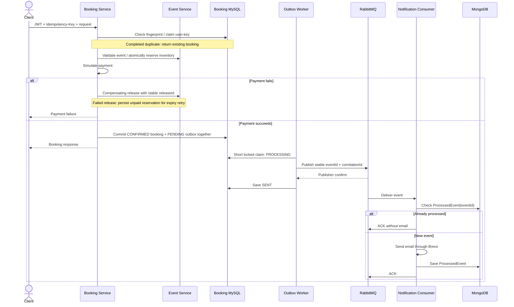

# Event Ticket Booking Platform

## 1. Overview

An event discovery and ticket booking platform with a Next.js customer application and one Angular management dashboard.

- **ADMIN:** platform-wide event, booking and statistics access, plus user/category/notification administration.
- **HOST:** creates events and manages only owned events, including their booking data and statistics.
- **CUSTOMER:** discovers events, books tickets and views their own bookings.

ADMIN and HOST share the dashboard. Backend authorization uses the JWT subject and `Event.createdBy`; navigation visibility is only a presentation control.

## 2. Architecture

| Component / repository | Responsibility and data |
|---|---|
| [Gateway](https://github.com/eventTicket-booking-platform/gateway-service-api) | Routes APIs; blocks external internal-inventory routes and restricts notification administration. |
| [Auth Service](https://github.com/eventTicket-booking-platform/auth-service-api) / Keycloak | Registration, verification, profiles and Keycloak-backed login/JWTs. Auth owns MySQL user/OTP data; Keycloak manages identity credentials. |
| [Event Service](https://github.com/eventTicket-booking-platform/event-service-api) | Owns MySQL events, ticket inventory and release receipts. |
| [Booking Service](https://github.com/eventTicket-booking-platform/booking-service-api) | Owns MySQL bookings, simulated payments, idempotency records and outbox events. |
| [Notification Service](https://github.com/eventTicket-booking-platform/notification-service-api) | Node.js consumer; owns MongoDB notification logs/processed events; sends email through Brevo. |
| [Config Server](https://github.com/eventTicket-booking-platform/config-server) / [configuration](https://github.com/eventTicket-booking-platform/config-repo) | Git-backed Spring configuration. |
| [Eureka](https://github.com/eventTicket-booking-platform/eureka-server) | Service registration/discovery infrastructure; current Feign clients also use configured URLs. |
| RabbitMQ | Asynchronous notification queues, delayed retries and dead-letter queues. |

Java/Spring Boot services coordinate validation and inventory through synchronous HTTP calls; messages trigger notifications asynchronously. Each business service owns its data: cross-service references use IDs, APIs and events, with no cross-database foreign keys. Databases may share infrastructure without sharing entity ownership.

Frontends: [customer application](https://github.com/eventTicket-booking-platform/event-ticket-booking-platform) and [shared admin/host dashboard](https://github.com/eventTicket-booking-platform/event-admin-dashboard). [Kubernetes manifests](https://github.com/eventTicket-booking-platform/k8) describe deployment; their presence does not demonstrate production availability.

## 3. Engineering Problems Solved

| Problem | Implemented decision |
|---|---|
| Overselling under concurrency | Atomic conditional decrement only when `availableQuantity >= requestedQuantity`; zero updated rows means rejection. |
| Payment failure after reservation | Compensate by releasing the exact quantities through Event Service. |
| Repeated release | Stable `releaseId` and transactional release receipts prevent duplicate inventory increments. |
| Duplicate booking requests | Required `Idempotency-Key`, request fingerprint and unique `(userId, idempotencyKey)` constraints. Completed requests replay the stored booking; changed bodies/in-progress claims conflict. |
| MySQL + RabbitMQ dual write | Confirmed booking and notification outbox row persist in the same local transaction; publication follows commit. |
| Multiple outbox workers | Short pessimistic claim changes `PENDING → PROCESSING`; broker I/O occurs outside that transaction. |
| Worker crash while processing | Timeout-based stale `PROCESSING` recovery returns abandoned claims to `PENDING`. |
| Late worker overwrite | Optimistic version protection rejects writes based on an outdated claim. |
| Uncertain publication | Correlated publisher confirms gate the outbox transition to `SENT`. |
| At-least-once delivery / duplicates | Stable outbox-derived `eventId`, MongoDB `ProcessedEvent` lookup before email, then successful-processing persistence before ACK. |
| Temporary notification failure | TTL retry queue routes messages back, preserving/incrementing `x-attempt`. |
| Invalid or exhausted notifications | Permanent invalid messages and exhausted retries go to the DLQ with failure metadata. |
| Distributed debugging | Booking `X-Correlation-ID` flows through the outbox, event payload, consumer logs and retry/DLQ headers. This is message correlation, not a distributed-tracing system. |
| Unreleased failed reservations | Store expiry when immediate failed-payment compensation fails; scheduler retries release and marks `EXPIRED` only after success. Paid/confirmed bookings are protected. |
| Cross-host access | JWT-derived ownership; Booking Service verifies through Event Service APIs and scopes lists/statistics before pagination/aggregation. |

## 4. Reliability Workflow

This normal confirmation path assumes the JWT supplies a recipient email. Payment is simulated synchronously.

Consumer delivery can precede the worker saving `SENT`. Publication failures retry through the outbox; consumer failures use retry/DLQ handling. Publisher confirmation establishes broker acceptance, not email delivery.

## 5. Testing Evidence

- **JUnit/Mockito and H2:** booking validation/idempotency, concurrent inventory updates, release deduplication/rollback, outbox claims/recovery, reservation expiry and backend ownership/HTTP authorization.
- **Jest:** consumer duplicate checks, duplicate-key races, missing IDs, transient retries and permanent/exhausted DLQ routing.
- **Angular tests:** dashboard access guards and ADMIN-only navigation.
- **Testcontainers (opt-in):** MySQL reservation concurrency, booking/claim uniqueness and stale outbox version protection; RabbitMQ publisher confirmation and queue delivery.

Run `mvn test` in Event and Booking Service without Docker. With Docker running Linux containers, run `mvn verify -Pintegration-tests` in each. Notification: `npm test -- --runInBand`. Dashboard: `npm test -- --watch=false`.

Recorded local validation (2026-10-10):

| Check | Actual result |
|---|---|
| Event Service normal Maven suite | 23 tests passed. |
| Booking Service normal Maven suite | 63 tests passed. |
| Notification Service after `npm ci` | 17 Jest tests passed. |
| Angular dashboard | 6 tests passed; production build passed with a bundle-size warning. |
| Next.js customer frontend | Production build passed. |
| Event/Booking `verify -Pintegration-tests` | Test classes compiled; both commands failed at container startup because the Docker daemon was unavailable. The one Event and two Booking integration classes have no passing database/broker result from this run. |
| k6 | All three JavaScript files passed syntax checks. No live API/load execution was performed. |

[k6 scripts and evidence instructions](https://github.com/eventTicket-booking-platform/booking-service-api/tree/main/performance) cover limited-inventory contention, completed-request replays and changed-body conflicts. **Script available; final metrics pending execution.** Record the commit/environment, initial stock, actual status/latency counters, final stock, confirmed-ticket totals and one-booking replay evidence. An end-state snapshot alone cannot prove inventory was never negative; local results do not establish production capacity.

CI now runs notification Jest tests, dashboard tests/build and the customer build before the required Sonar scan. These are local validation results, not a completed GitHub Actions or deployment run.

## 6. Authorization Model

| Role | Backend-enforced access |
|---|---|
| ADMIN | Platform-wide event, booking and statistics access; admin-only management. |
| HOST | Create events; manage only events whose `createdBy` matches the JWT subject. View bookings/statistics only for those events. |
| CUSTOMER | Normal customer operations and own booking details/history; no management access. |

ADMIN and HOST use the same Angular dashboard, with role-filtered navigation/actions. Frontend filtering is presentation only; the backend is authoritative. Booking Service checks event ownership through Event Service APIs using the caller's JWT, without accessing its database. Authenticated non-owners receive 403; existing authentication handles missing/invalid tokens.

## 7. Trade-offs / Limitations

- **At-least-once, not exactly-once.** Email can succeed before a crash prevents `ProcessedEvent` persistence. Concurrent consumers can both pass the lookup and send; the unique index prevents duplicate records, not both emails.
- **Local transactions, not distributed atomicity.** A crash after remote reserve but before local booking commit can orphan inventory. Expiry recovers recorded failed compensation only, without inferring unrecorded operations or backfilling historical pending bookings.
- **Simulated payment.** No payment-gateway integration, asynchronous payment completion or customer booking-cancellation endpoint. Successful bookings currently need no checkout expiry window; no full Saga was introduced for this workflow.
- **Operational recovery remains necessary.** Exhausted outbox events become `FAILED`; stale idempotency claims, DLQs and orphan reservations require investigation/reconciliation. Timeouts must exceed batch duration; clocks must be reasonably synchronized. Claims can lock more rows than the published batch.
- **Messaging has a handoff gap.** RabbitMQ fits asynchronous notification/work-queue delivery. Consumer retry/DLQ forwarding uses an ordinary channel before ACK, without its own publisher-confirm handshake; this is not atomic.
- **Deployment boundaries matter.** Internal inventory commands and Notification Service require private backend ports. Historical client-supplied ownership needs auditing. Missing JWT email skips notification outbox creation.

## 8. Local Development

1. Install Java 17+, Maven (or service wrappers), and Node.js/npm compatible with the frontend packages. Provision MySQL, MongoDB, RabbitMQ and Keycloak with the configured realm/client. Email and uploads require Brevo and AWS S3 settings.
2. Clone the linked repositories. Use their `.env.example` files and the [configuration README](https://github.com/eventTicket-booking-platform/config-repo) to supply credentials, JWT issuer and service URLs in each service's environment. Config-repo examples are references, not automatically loaded by Config Server. Notification loads `.env`, then `.env.<NODE_ENV>`. Never commit credentials.
3. Set `CONFIG_GIT_URI` to your configuration repository; Config Server's checked-in local path must change on another machine. Start Eureka/Config Server, then business services and Gateway. Run `mvn spring-boot:run` in each Spring repository.
4. Notification: `npm ci`, then `npm run dev`. Customer frontend: `npm ci`, then `npm run dev`. Dashboard: `npm ci`, then `npm start`.

Configured local ports: customer `3000`, dashboard `4200`, Gateway `9090`, Event `9091`, Auth `9092`, Booking `9093`, Notification `9094`, Config `8888`, Eureka `8761`. Browser APIs use the gateway's `/api` prefix; `POST /api/booking-service/api/v1/bookings` requires a bearer JWT and `Idempotency-Key`. Service READMEs provide setup/rollout details. Deploy Event Service's release-receipt/ownership support before dependent Booking Service changes.

## 9. Final Infrastructure Validation Pending

SonarQube EC2 and GKE are intentionally offline while implementation is being finalized. Repository changes and local checks do not establish deployed readiness.

1. Restore SonarQube EC2 and rerun the required scans.
2. Restore GKE.
3. Rotate previously committed credentials and update private environment/CI secrets before deployment. Removing them from HEAD does not remove Git history.
4. Build/push fresh images and deploy.
5. Smoke-test CUSTOMER, HOST and ADMIN, including ownership denials.
6. Run the MySQL/RabbitMQ integration profiles with a working Docker daemon.
7. Run k6 against an isolated fixture and retain actual results, if appropriate.

Docker-dependent integration assertions, live k6 results, Sonar scans and deployed smoke tests remain pending. No production capacity or exactly-once delivery is claimed.
